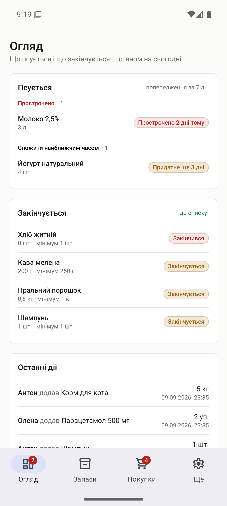
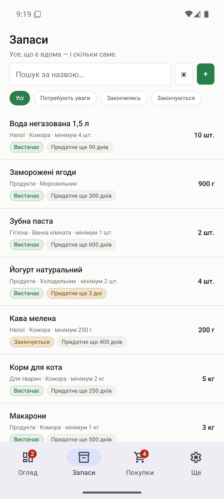
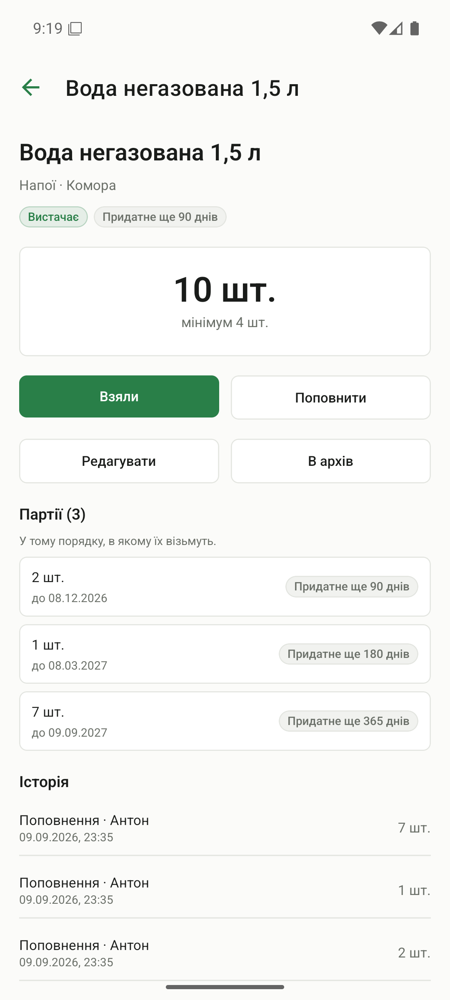
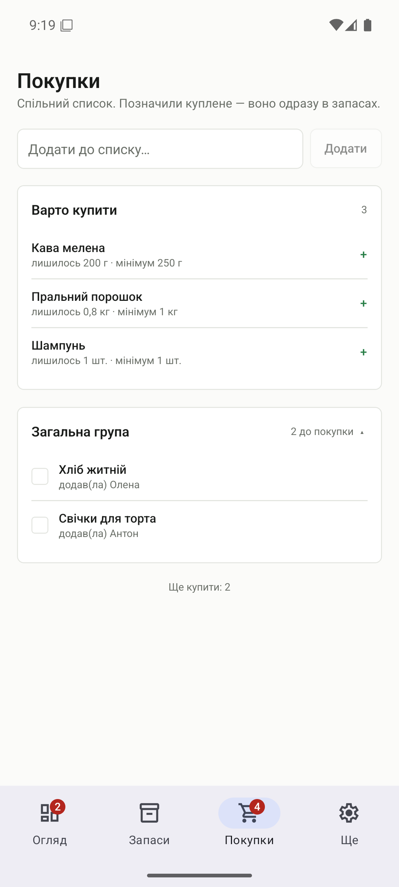
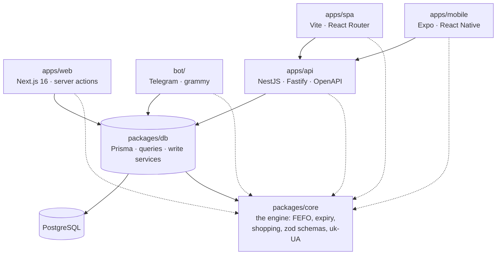

# Supplies

Household stock and expiry tracker for a family. **Four clients over one
engine**: a Next.js web app, a React Native phone app, a Vite SPA, a Telegram
bot — and a NestJS API that the SPA and the phone speak to.

**The interface is Ukrainian.** Everything technical — this file, the docs,
code, comments, identifiers, commit messages — is English. See
[Language](#language).

| | |
|---|---|
|  |  |
|  |  |

## What it does

- **Shared pantry.** Everyone has their own login; the household sees one
  inventory.
- **One product, many batches.** Ten bottles of water expiring on three
  different dates is one item with three batches, entered in a single submit.
- **FEFO consumption.** Taking stock draws from whatever expires soonest and
  never touches an expired batch, so "we drank it" cannot be recorded
  *silently* against milk that had already gone off. Taking from one named
  batch, expired included, is a separate deliberate act — and still records
  eating it as eating it, not as waste.
- **Shared shopping list**, grouped by shop or any other axis. Ticking
  something off puts it straight into stock.
- **Barcode scanning.** Scan to jump to what you already have, or to start
  creating what you do not. A new item fills itself from Open Food Facts and
  its siblings, falls back to METRO Ukraine for own-label goods and to GS1
  Ukraine for the manufacturer, and can contribute back what none of them knew.
- **Sets of interchangeable products.** Two brands of milk count as one thing
  for restocking: one minimum for the set, one reminder, while each stays a
  separate item with its own batches and dates.
- **A daily reminder** of what is expiring or running out — as a Telegram
  message and as a phone notification.

## How it fits together



Solid arrows are calls; dotted ones are the rules every client shares.

**The rules have one implementation and five callers.** A stock write from the
web app, the phone, the bot or the API runs the same
`packages/db/stock-service`, over the same `packages/core` engine, in the same
transaction. `packages/core/contracts` describes the wire once as zod objects:
`z.infer` gives the clients their types, `z.toJSONSchema` gives `/docs` its
schemas, and the API's own e2e suite parses real responses against them, so a
field that stops being sent fails a test rather than a screen.

An ESLint boundary enforces what types cannot — `packages/core` may import
neither Prisma nor React nor Next nor a Node builtin, because a React Native
bundle has none of them, and `apps/mobile` may not import `@supplies/ui`
because that package renders to a DOM.

## Stack

| Layer | Choice |
|---|---|
| Web | Next.js 16 (App Router), React 19, TypeScript strict |
| Phone | Expo SDK 57, Expo Router, NativeWind 4, native tabs |
| SPA | Vite, React Router, TanStack Query |
| API | NestJS + Fastify, zod validation, OpenAPI at `/docs` |
| Bot | grammy — webhook in production, long polling in development |
| Data | PostgreSQL 17, Prisma 7 with the `@prisma/adapter-pg` driver adapter |
| Auth | Auth.js for the web; JWT access + rotating refresh tokens for the API |
| Styling | Tailwind v4 + shadcn/ui on Base UI (web), NativeWind (phone) |
| Money and quantities | decimal.js everywhere — never float arithmetic |
| Barcode | `BarcodeDetector` with a `@zxing/browser` fallback on web, `expo-camera` on the phone |
| AI | Claude API, Feature 32 recipe suggestions only, off by default |

## Quick start

```bash
pnpm install
```

```bash
cp .env.example .env
```

Fill in `AUTH_SECRET`:

```bash
node -e "console.log(require('crypto').randomBytes(32).toString('base64'))"
```

Then bring up the database and seed it:

```bash
pnpm db:up
```

```bash
pnpm db:migrate
```

```bash
pnpm db:seed
```

```bash
pnpm dev:all
```

Demo login: `anton@example.com` / `supplies123`.

`dev:all` runs the Next app on :3000, the API on :3200 and the SPA on :5173
against one database, which is the arrangement worth seeing: take a bottle in
one and watch the number change in the others. `pnpm dev:stop` frees the ports.

Postgres runs in Docker on host port **5434**. Docker Desktop must be running,
and it does not start automatically after a reboot — a Prisma error on whatever
query happens to run first almost always means the database is down, not that
the query is wrong.

For the phone app, `pnpm mobile:dev` and scan the QR with Expo Go. Remote push
does not work there, by Expo's design — see
[apps/mobile/CLAUDE.md](apps/mobile/CLAUDE.md).

## Commands

| Command | What it does |
|---|---|
| `pnpm dev:all` / `dev:stop` | All three web processes at once |
| `pnpm dev` · `api:dev` · `spa:dev` | One at a time |
| `pnpm mobile:dev` · `mobile:android` · `mobile:bundle` | Expo dev server, a connected device, a device-free bundle |
| `pnpm build` / `pnpm start` | Production build and run |
| `pnpm verify` | Lint, typecheck and unit tests — the pre-commit gate |
| `pnpm test` | vitest over the pure rules and the data layer, no database |
| `pnpm test:db` | Integration smoke test against a live seeded database |
| `pnpm test:api:e2e` | The API against the same database, contracts included |
| `pnpm test:e2e` / `test:e2e:spa` | Playwright over each web client's own production build |
| `pnpm db:up` · `db:migrate` · `db:seed` · `db:studio` | Database |
| `pnpm bot:dev` / `bot:start` | Telegram bot (long polling) |
| `pnpm digest:run` | The daily expiry and out-of-stock reminder |
| `pnpm barcode <code> <out.png>` | An EAN-13 as a PNG — how the scanner is tested without hardware |
| `pnpm backup:prod` / `backup:verify` | Dump production, and prove the dump restores |
| `pnpm db:prod-copy` | Load a production dump locally and point the app at it |

## Repository

A pnpm workspace. Every deployable is an app, every shared thing is a package,
and the root holds no application code.

```
apps/web/      Next.js — the app in production
apps/api/      NestJS + Fastify — REST + OpenAPI at /docs
apps/spa/      Vite + React Router — the same app without a framework
apps/mobile/   Expo + React Native — the same app on a phone
bot/           @supplies/bot — Telegram bot and the daily digest
packages/core/ the engine: stock, FEFO, expiry, formatting, contracts, zod schemas
packages/db/   Prisma client, the read queries and every write service
packages/ui/   the design system the two web clients share
prisma/        one schema, one seed — shared by all of them
```

## Where to look

If you are reading this to judge the code rather than to run it, these are the
files that carry the ideas:

| | |
|---|---|
| [`packages/core/src/stock.ts`](packages/core/src/stock.ts) | FEFO, and why taking stock is a *plan* the caller applies rather than a mutation |
| [`packages/db/src/stock-service.ts`](packages/db/src/stock-service.ts) | the single write path — it takes an `Actor` instead of reading a session, which is what makes "one implementation, five front ends" real |
| [`packages/core/src/contracts/`](packages/core/src/contracts) | the wire described once, as the source of both the clients' types and the API's schemas |
| [`apps/api/src/auth/tokens.ts`](apps/api/src/auth/tokens.ts) | refresh rotation with replay detection, and a grace window that had to be earned |
| [`packages/core/src/format.ts`](packages/core/src/format.ts) | Ukrainian plurals and grouping written out, because Hermes' `Intl` is not a browser's |
| [`apps/mobile/metro.config.js`](apps/mobile/metro.config.js) | the four lines that make Metro work with pnpm, one of which contradicts every monorepo guide |
| [`eslint.config.mjs`](eslint.config.mjs) | the import bans that keep the engine portable, each proved to fire |

Every directory has a `CLAUDE.md` explaining what lives there and which
mistakes have already been made in it.

## How the domain works

An **Item** is a kind of thing ("Молоко 2,5%"). A **StockBatch** is a concrete
lot of it with its own quantity, *its own expiry date* — because two cartons
bought a week apart go off on different days — and *its own storage location*,
because the same product can sit in the kitchen fridge and the basement fridge
at once.

An **ItemGroup** is a set of interchangeable items. It owns the low-stock
threshold, so a household short of "milk" is reminded once rather than once per
brand; a grouped item's own minimum is ignored while it is in the set, and
every member must share one unit, since litres and pieces cannot be summed.

An item's quantity is **never stored**. It is the sum of its live batches,
computed on read, so the number cannot drift away from reality. Every batch
change writes a `StockMovement` in the same transaction, which is what makes
"who used the last of it" answerable.

Stock state is `OUT` / `LOW` / `OK`; expiry state is `EXPIRED` / `SOON` /
`FRESH` / `NONE`. They are tracked and displayed **independently**, because an
item can be well stocked and half-expired, and collapsing them into one badge
would hide whichever half is worse.

A minimum of **0 means no reminders at all** — not even when the item runs out.
The state still reads `OUT` and the badge still says so; what stops is the
nagging.

[PROJECT_PROMPT.md](PROJECT_PROMPT.md) §3 has the full rules; §3.6 is a worked
example that `packages/core/src/stock.test.ts` reproduces verbatim.

## Language

Ukrainian is the **interface language**, and only that:

- **UI copy is written in Ukrainian directly in the components** — no i18n
  library, no message catalogs, no locale switcher. What you read in the JSX is
  what the user sees.
- Strings produced outside React (engine rule errors, validation messages, bot
  replies, the digest) live in `@supplies/core/messages` as a typed key →
  Ukrainian map. Pure functions return the key and its params, never a
  formatted sentence, so tests assert on stable keys instead of prose.
- Dates and numbers format through `@supplies/core/format` (`uk-UA`,
  `DD.MM.YYYY`, decimal comma, and real `one/few/many` plurals — "1 пляшка /
  2 пляшки / 5 пляшок"). Both the plural rule and the thousands grouping are
  written out rather than asked of `Intl`, because Hermes answers differently
  from a browser and the difference was invisible until a phone showed it.
- Seed data is Ukrainian, since it is content rather than code.

**Everything else is English:** this README, `CLAUDE.md` and the per-area docs,
`PROJECT_PROMPT.md`, code, comments, identifiers, and commit messages. Where
English prose quotes a literal UI label — «Загальна група», for instance — the
Ukrainian stays, because the doc is naming something the user actually sees.

## Testing

| Suite | What it is for |
|---|---|
| 378 unit tests | the rules, with no database and no framework. The engine's tests are colocated with it |
| 52 integration checks | the same rules through Prisma against a live database, written as properties rather than against particular seeded rows |
| 56 API e2e checks | the wiring nothing else can see — a guard actually refusing, zod actually rejecting, a replayed refresh token actually revoking every session |
| Playwright, twice | each web client over its own production build |
| `expo-doctor` + a Hermes bundle | the phone app in CI, with no device attached |

The split is deliberate: the pre-commit hook runs only what needs no Docker,
because a hook that fails when Docker is down teaches people to reach for
`--no-verify`.

## Deployment

[docs/DEPLOYMENT.md](docs/DEPLOYMENT.md) — Vercel + Neon, free tier. Migrations
run as part of the build, so merging to `main` is the whole deploy. The API
and the SPA are not deployed yet; that section of the guide lists what their
first deploy needs.

## Documentation

- [PROJECT_PROMPT.md](PROJECT_PROMPT.md) — the specification: domain rules,
  data model, and every feature with the reason for each rule.
- [docs/ARCHITECTURE.md](docs/ARCHITECTURE.md) — boundaries, what is shared
  and why, configuration, auth, hosting, and the decision log.
- [docs/ROADMAP.md](docs/ROADMAP.md) — what is left to build, known defects,
  and proposed improvements.
- [CLAUDE.md](CLAUDE.md) — stack, layout, commands, conventions.
- [CONTRIBUTING.md](CONTRIBUTING.md) — the branch, PR and CI flow.
- [docs/archive/](docs/archive/README.md) — the original plans and the full
  story of how each feature was built.
- Per-area: [prisma](prisma/CLAUDE.md) ·
  [apps/web/components](apps/web/components/CLAUDE.md) ·
  [apps/api](apps/api/CLAUDE.md) · [apps/spa](apps/spa/CLAUDE.md) ·
  [apps/mobile](apps/mobile/CLAUDE.md) · [bot](bot/CLAUDE.md) ·
  [packages/core](packages/core/CLAUDE.md) ·
  [packages/db](packages/db/CLAUDE.md) · [packages/ui](packages/ui/CLAUDE.md)

## Status

Features 0–35 are implemented, except offline writes (Feature 31), which are
parked. Features 0–32 are running in production on Vercel + Neon. The API, the
SPA and the phone app live on `feature/shared-core` and have not shipped yet.
What is left is in [docs/ROADMAP.md](docs/ROADMAP.md).

Not exercised by any automated check: the **camera barcode scan** and the
**drag-to-reorder gesture** on the web clients — a headless browser can supply
neither a camera nor a touch drag. The scan is no longer entirely unproven: on
the phone it has been driven end to end against a generated barcode hung on the
Android emulator's virtual-scene wall. **Push delivery** is likewise built and
unproven — it needs FCM credentials and a real device.
