# Architecture

How Supplies is put together, and the decisions that keep it that way. The
**rules of the domain** are in [PROJECT_PROMPT.md](../PROJECT_PROMPT.md); this
document covers the shape of the code that runs them. What is still to be built
is in [ROADMAP.md](ROADMAP.md).

The plan that produced this shape, with its day-by-day log, is archived at
[archive/SPA_API_PORT.md](archive/SPA_API_PORT.md). Section numbers here are
cited from code comments, so renumbering them means updating those comments.

---

## 1. The shape — one engine, several clients

```mermaid
flowchart TD
    web["apps/web<br/>Next.js · server actions"]
    spa["apps/spa<br/>Vite · React Router · TanStack Query"]
    mobile["apps/mobile<br/>Expo · React Native"]
    bot["bot/<br/>Telegram · grammy"]
    api["apps/api<br/>NestJS · Fastify · OpenAPI"]
    db[("packages/db<br/>Prisma · queries · write services")]
    core["packages/core<br/>rules · formatting · zod schemas · contracts"]
    ui["packages/ui<br/>web design system"]
    pg[("PostgreSQL")]

    spa -- HTTP --> api
    mobile -- HTTP --> api
    web --> db
    bot --> db
    api --> db
    db --> core
    db --> pg
    web -.-> ui
    spa -.-> ui
    web -.-> core
    spa -.-> core
    mobile -.-> core
    bot -.-> core
    api -.-> core
```

| Layer | Owns | May import |
|---|---|---|
| `packages/core` | every business rule, the Ukrainian message catalogue, `uk-UA` formatting, the zod request schemas, the wire contracts | `decimal.js`, `zod`, and nothing that needs a runtime. No Prisma, React, Next or Node builtins (one exception, §3) |
| `packages/db` | the Prisma client, the read queries, and **every write service**: stock, items, shopping, settings, accounts, barcodes, recipes, push, Telegram links | `packages/core`, Prisma |
| `packages/ui` | the web design system: tokens, Base UI primitives, the state badges, three per-device preference hooks | React, Base UI. No `next/*`, no `react-router` |
| `apps/web` | the Next.js app: pages, server actions (session guard + validation + `revalidatePath`), the Telegram webhook, the cron route | `core`, `db`, `ui`, `bot` |
| `apps/api` | NestJS: authentication, household scoping, HTTP, OpenAPI | `core`, `db`, `bot` (the digest only) |
| `apps/spa` | the same app as `apps/web`, without a framework | `core`, `ui`. **Never `db`** |
| `apps/mobile` | the same app on a phone | `core`. **Never `db` or `ui`** |
| `bot/` | the Telegram bot and the daily digest | `core`, `db` |

**The rules have one implementation.** A stock write from the web app, the
phone, the SPA, the bot or the API runs the same function in
`packages/db/src/stock-service.ts`, over the same `packages/core` engine, in
the same transaction. The services take an `Actor` (`{ userId, householdId }`)
rather than reading a session, which lets four front ends share them without
any of them knowing how the others authenticate.

**The bot talks to the database directly**, not through the API. It is a
server-side process with database access, so routing it through HTTP would add
a network hop and a failure mode and buy nothing.

**The root holds no application code.** It is the workspace, the Prisma
schema, the scripts and the docs. Every deployable is under `apps/`, and every
shared thing is a package.

## 2. Why one repository

The thing this codebase demonstrates is that **the rules were factored so that
a second, third and fourth client could be added without rewriting any of
them**. Copy the engine into a second repository and that claim disappears:
you get two repos that each show one thing, and a divergence problem the day
FEFO changes in one and not the other.

What one workspace buys in practice:

- the pure modules exist once and are imported by every consumer;
- one CI run proves the engine, the API and every client together;
- `packages/core` is either green for everyone or red for everyone.

What it costs: the repository is large, and it does not read in three minutes.
That trade was made knowingly. The README is therefore treated as part of the
deliverable: it opens with the architecture, not with setup steps.

## 3. Boundaries, and how they are enforced

A convention that is not enforced is one that eventually breaks.
`eslint.config.mjs` encodes every boundary below, and each ban has been proved
to fire against a file that deliberately violates it.

| Where | Banned | Why |
|---|---|---|
| `packages/core` | Prisma, React, Next, `server-only`, the `@/` alias, Node builtins except `node:crypto` | It is bundled by Next, Vite and Metro. A browser fails loudly on a Node builtin; **Metro resolves it to nothing and the app crashes on a phone** |
| `packages/ui` | `next/*`, `next-themes`, `next-auth`, `react-router`, `@tanstack/*`, `sonner` | It renders under two routers. Navigation arrives through Base UI's `render` prop; refusals come back as booleans from callbacks the host supplies |
| `apps/spa`, `apps/mobile` | `@supplies/db`, Prisma, Node builtins, `@supplies/core/claude`, `@supplies/core/telegram-link`, test files | Every write goes over HTTP. The two core modules are server-only (an API key, `node:crypto`) |
| `apps/mobile` | `@supplies/ui`, `next/*` | React Native has no DOM |
| every app | importing a sibling app | If two apps need something, it moves into a package |

Three structural rules sit beside the lint:

- **No barrel files.** `packages/core` exports `"./*": "./src/*.ts"`, so a
  consumer imports `@supplies/core/stock`, never `@supplies/core`. A barrel
  would put `node:crypto` into the module graph of every phone screen that
  imported anything at all.
- **Packages ship source, not `dist`.** There is no build step and no stale
  artefact. The cost is one line per bundler: `transpilePackages` in
  `next.config.ts`, and `watchFolders` and `unstable_enablePackageExports` in
  `apps/mobile/metro.config.js`.
- **Anything compiled by `nest build` imports across packages relatively.**
  tsc never rewrites a module specifier, so `@supplies/core/stock` would
  survive into `dist` and make Node resolve it to a `.ts` file it cannot run.
  The API confines that to four bridge files (`src/core.ts`, `src/db.ts`,
  `src/contracts.ts`, `src/bot.ts`). `packages/db` and `bot/` import
  `../../core/src/…` for the same reason, because the API compiles them too.

`server-only` is allowed in exactly one file, `apps/web/lib/queries.rsc.ts`.
Adding it to `packages/db` kills the bot, the digest, the smoke test and the
whole API at startup.

## 4. What is shared, and the rule that decides it

> The clients share a **database, not a codebase**. Duplicated views or
> duplicated presentation logic between them is acceptable. A shared component
> is acceptable **only while it costs neither host its own idioms**. Once
> sharing forces an app into an idiom it would not otherwise choose, the
> sharing is wrong and the duplication is right.
>
> — decided 2026-09-07, after the Phase 2.10 audit

This test is stricter than "is it used twice", and it applies to every new
candidate individually:

| Shared | Why it passes |
|---|---|
| `packages/core` — rules, messages, formatting, schemas, contracts | No framework at all. A rule in two places is two definitions of "low" |
| `packages/db` — queries and write services | Server-side only, and every server-side host calls it the same way |
| `packages/ui` — web design system | Base UI + Tailwind is plain React. Both web hosts render it unchanged, and navigation is injected |

| Not shared | Why |
|---|---|
| UI between web and phone | No DOM on a phone. `apps/mobile` rebuilds its primitives and transcribes the colour tokens as hex, because React Native cannot parse `oklch` |
| The API client between the SPA and the phone | The SPA's refresh token is an httpOnly cookie; the phone's lives in SecureStore and travels in the body. The transport differs, so `client.ts` is written twice. The query keys above it are identical today; see [ROADMAP.md](ROADMAP.md) |
| The toaster and the theme switch | They depend on how each host stores the theme (`next-themes` vs a small hook). The tokens are shared; the mechanism that flips them is not |

## 5. Configuration — every origin is a variable

Decided 2026-09-04, before any domain existed: **no domain appears in source.**
Every origin is an environment variable with a working localhost default, so a
first deploy means filling in values, not editing code.

| Variable | Local default | Read by |
|---|---|---|
| `API_PORT` | `3200` | API |
| `CORS_ORIGINS` | `http://localhost:5173,http://localhost:3000,http://localhost:8081` | API, as a comma-separated allowlist (8081 is `expo start --web`). Must be `https://` in production |
| `COOKIE_DOMAIN` | empty, meaning a host-only cookie | API |
| `COOKIE_SAMESITE` | `lax` | API |
| `COOKIE_SECURE` | `false` | API |
| `TRUST_PROXY` | `false` | API. Behind a host's proxy, the hop count (usually `1`) or the proxy's addresses, so the rate limiter sees real client addresses |
| `VITE_API_URL` | `http://localhost:3200` | SPA, **inlined at build time** |
| `EXPO_PUBLIC_API_URL` | the dev server's own host on port 3200 | phone, inlined at build time; set per EAS environment |
| `APP_URL` | `http://localhost:3000` | Next app and API, for links in reset and invite emails |
| `TELEGRAM_WEBHOOK_URL` | none | `pnpm bot:webhook:set`. Kept separate from `APP_URL` so switching the bot between laptop and deployment never edits it |

Local port map, chosen so nothing collides: **3000** Next dev · **3100**
Playwright's Next build · **3200** API · **3210** the API that Playwright starts
for the SPA · **4173** `vite preview` · **5173** Vite dev · **8081** Metro /
`expo start --web` · **5434** Postgres · **5435** a production copy
(5432 and 5433 belong to other projects on the same machine).

Two rules make this hold up:

1. **Config fails at boot, loudly.** `apps/api/src/config/env.ts` validates
   the environment through a zod schema before any provider is constructed and
   names every bad variable in one message. A malformed origin is a refusal to
   start, not a CORS error at 2 a.m. that reads like a browser bug.
2. **Cross-site cookie settings are a matched set.** `SameSite=None` without
   `Secure` is dropped silently by every current browser, so the schema
   rejects that combination instead of letting it fail in one browser and not
   another.

## 6. The design system — `packages/ui`

The first SPA screens grew their own four hand-rolled components and a
hard-coded palette next to a Next app with themed Base UI primitives and a dark
mode. That was the same duplication the engine had been factored to prevent,
one layer up, and it was found by looking rather than by a test. So the
primitives moved into a package both web clients render.

- **Tokens** live in `packages/ui/src/theme.css` (oklch, `.dark`, the radius
  scale). The state colours `--warning`, `--success` and `--destructive` exist
  so that an expiry chip never hardcodes a hex value.
- **`state-badges`** is domain code in a UI package on purpose. Stock and
  expiry are two chips, never merged, because an item can be well stocked and
  half-expired. Every client has to make that choice the same way.
- **The phone transcribes the tokens** into `apps/mobile/tailwind.config.js`
  as hex rather than importing them.

Details, including the `style` export condition and the `@source` line Tailwind
needs: [packages/ui/CLAUDE.md](../packages/ui/CLAUDE.md).

## 7. The wire — `packages/core/contracts`

One zod object per response shape, and three things derive from each one:

- the TypeScript type the SPA and the phone consume (`z.infer`);
- the OpenAPI schema that `/docs` publishes (`z.toJSONSchema`);
- a parser that the API's e2e suite runs every real response through.

The third is what keeps the first two honest. A field that disappears, is
renamed or changes type fails in `pnpm test:api:e2e`, not on a screen.

**This runs the opposite way from the original plan**, which was to generate
client types *from* the OpenAPI document. The API had no response DTOs, so a
generator would have emitted `unknown` everywhere. Writing a DTO class per
shape would have been a second definition of each response, which is the
bargain the API had already refused for requests (no class-validator, §8).
Adding a field to an endpoint therefore means adding it to the contract first;
a field added only on the client is one the server is not known to send.

Refusals travel as a **message key and its params**, never as prose
(`{ statusCode, key, params?, message }`; `apiErrorSchema`), so every client
renders the same Ukrainian catalogue from `@supplies/core/messages`. `message`
is there for a human reading the API by hand. Clients switch on `key`.

## 8. Authentication — two systems, on purpose

| Client | Mechanism |
|---|---|
| `apps/web` | Auth.js v5, Credentials provider, JWT session cookie (8 h) carrying `id` and `householdId`. `requireSession()` re-reads the user on every request, so a deactivated account loses access at once |
| `apps/spa` | Access JWT (15 min) in memory, plus a rotating refresh token in an httpOnly cookie |
| `apps/mobile` | The same access JWT in memory, plus the refresh token in `expo-secure-store`, sent in the request body |
| `bot/` | A Telegram chat linked to a user through a signed, 15-minute, stateless link token. `resolveChat()` re-reads the user on every update |

The API side ([PROJECT_PROMPT.md](../PROJECT_PROMPT.md) Feature 34):

- **Refresh tokens rotate on every use** and only their SHA-256 is stored.
  Presenting an already-rotated token is treated as theft: every session for
  that user is revoked.
- **A 10-second grace window** (`REFRESH_GRACE_MS`) lets a just-rotated token
  answer once more, so two browser tabs restoring at the same moment do not
  look like theft. Only `revokedReason = rotated` earns it. Without that
  column, a theft response would put the whole revoked family inside the
  window.
- **Refreshing is single-flight inside each client.** Neither client posts to
  `/auth/refresh` directly; both call `refreshSession()`. A double-invoked
  React effect once replayed the token it had just rotated and signed the user
  out immediately after registering.
- **A new password ends the API sessions.** A reset revokes every refresh
  token. A change revokes all but the caller's own, which the access token
  names in its `sid` claim. Both are marked `revokedReason = password`,
  which a later refresh answers with a plain 401 instead of the theft
  response, so the device that was signed out on purpose cannot take the kept
  session down with it.
- **`API_JWT_SECRET` is separate from `AUTH_SECRET`.** The latter also signs
  Auth.js sessions and Telegram link tokens, so rotating one secret to end API
  sessions would otherwise sign everyone out of the web app as well.
- **Validation is zod, not class-validator.** `ValidationPipe` is absent on
  purpose: the API validates with the same `@supplies/core/validation` schemas
  the forms use. Two validation libraries would mean two definitions of a
  valid item.

Two auth systems coexisting is deliberate. Moving the Next app onto the API's
tokens is possible and buys nothing today.

## 9. Client caching — the query-key map

`revalidatePath` has no equivalent outside Next. In the SPA and on the phone,
every mutation has to name what it made stale, so both clients have a
query-key map (`apps/spa/src/api/keys.ts`, `apps/mobile/lib/api/keys.ts`)
**written before the screens, not during them**.

The rule the map encodes: **a stock write changes four things.** The item's
own quantity, its place in the list, the dashboard's buckets, and the nav
badges. Forgetting the last one is the classic bug: the number in the corner
quietly disagreeing with the page under it. `apps/spa/e2e/spa.spec.ts` is what
proves the map right, because a forgotten key looks exactly like a successful
write until someone notices.

## 10. Hosting

| Deployable | Host | State |
|---|---|---|
| `apps/web` (with the bot webhook and the cron route) | Vercel Hobby, Root Directory `apps/web`, *include files outside the root* on | **production** (from `main`) |
| PostgreSQL | Neon free tier, `us-east-2` | **production** |
| `apps/api` | a long-lived Node host (Railway, Fly or Render), US East | not deployed |
| `apps/spa` | a second Vercel project on the same repo, Root Directory `apps/spa` | not deployed |
| `apps/mobile` | EAS Build, sideloaded APK | builds; points at a LAN API until the API is deployed |

**The API does not belong on serverless.** Nest is built for a long-lived
process. On Vercel it would cold-start on every call the phone makes, the
in-memory `@nestjs/throttler` counter would read zero on every fresh instance,
and Prisma would need extra connection care. Requirements any host has to meet
before the first deploy are in [DEPLOYMENT.md](DEPLOYMENT.md) §6. The two that
are easy to miss: the region (the database is in Ohio, and each request makes
several round trips to it), and `TRUST_PROXY`. Behind a proxy, the rate
limiter otherwise keys every request on the proxy's address.

**Three origins make CORS real work.** The refresh cookie needs either a
shared parent domain (`api.example` + `app.example`, `Domain=.example`,
`SameSite=Lax`) or `SameSite=None; Secure` across sites (§5).

**Each Vercel project should skip builds it does not need**, via an Ignored
Build Step such as
`git diff --quiet HEAD^ HEAD -- apps/web packages bot prisma`.

## 11. Known frictions

- **Prisma must never enter a browser or Metro bundle.** The generated client
  opens with `node:process`, `node:path` and `node:url`. That is why the engine
  uses `decimal.js` directly instead of `Prisma.Decimal` (they are the same
  library; `packages/db/src/prisma-decimal.test.ts` pins that they
  interoperate), why units are declared in `@supplies/core/units` rather than
  imported from the generated enums, and why §3's bans exist.
- **Metro and pnpm.** pnpm gives each package a private `node_modules` and
  hoists nothing, so `disableHierarchicalLookup` must stay **off**, the
  opposite of most monorepo guides. Every dependency a file names must be
  declared by the package that contains it; this has bitten five times. See
  [apps/mobile/CLAUDE.md](../apps/mobile/CLAUDE.md).
- **Hermes has a partial `Intl`.** No `PluralRules`, and `NumberFormat`
  rejects a BigInt. `packages/core/src/format.ts` writes the Ukrainian plural
  rule and digit grouping out by hand and tests them against Node's real
  implementation. Check any new `Intl` API, *and its arguments*, on a device.
- **The phone is the most expensive place to find a bug.** `expo start --web`
  runs in a browser with full ICU and cannot reproduce Hermes; the emulator
  cannot reproduce a real network. Both have hidden real bugs before.
- **Don't paint into Android.** iOS is parked, not cancelled. Safe areas and
  keyboard handling live in the shared `Screen` component, the camera is
  `expo-camera`, and no Android-only library is used, so the iOS pass stays
  cheap.

## 12. Decision log

| # | Date | Decision | Consequence |
|---|---|---|---|
| 1 | 2026-09-04 | **Full parity** across clients | Every screen exists on the web, the SPA and the phone |
| 2 | 2026-09-04 | **NestJS** (Fastify adapter) for the API | Modules, guards and OpenAPI at `/docs`. Fastify standalone and tRPC were declined: the structure is part of what the repo demonstrates |
| 3 | 2026-09-04 | **One workspace** | §2 |
| 4 | 2026-09-04 | **Offline parked** | `feature/offline-sync` is a design record, not resumable code. See [ROADMAP.md](ROADMAP.md) |
| 5 | 2026-09-04 | **iOS after Android** | Then parked entirely by decision 11 |
| 6 | 2026-09-04 | **No deadline** | Bought the Nest ceremony and full parity |
| 7 | 2026-09-04 | **Domains unknown, so everything is env-driven** | §5 |
| 8 | 2026-09-06 | **The Next app moved to `apps/web`** early | The layout stopped implying that Next was the project and the rest were attachments |
| 9 | 2026-09-06 | **The design system is shared** | §6 |
| 10 | 2026-09-06 | **SPA parity gates the phone** | A third client built on a second-rate second client inherits its gaps. Closed 2026-09-07 |
| 11 | 2026-09-11 | **iOS is not a priority** | Phase 5 parked. What it already has stays, because it protects Android too |
| 12 | 2026-09-07 | **Share a database, not a codebase** | §4 |
| 13 | 2026-09-08 | **Contracts are zod-first** | §7. The planned `packages/api-client`, generated from OpenAPI, was never built |
